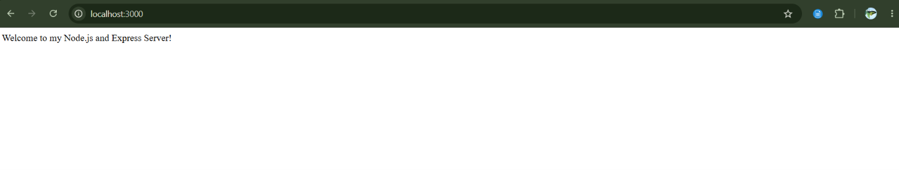
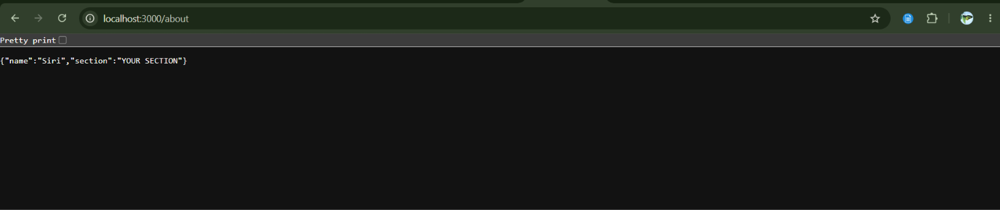
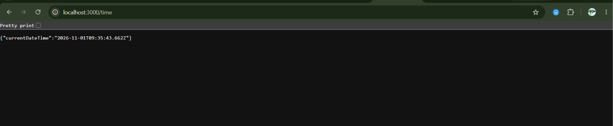
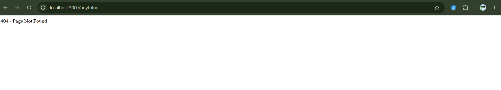

# Lab 1 – Node.js and Express Server

## 🚀 Live Deployment
https://siri-lab-1.onrender.com

## Student Details
- **Name:** [Renukunta Siri]
- **Registration Number:** [252U1R8081]
- **Section:** [S-13, 204, 2B]
- **Course:** B.Tech – CSE (Quantum Engineering)

## Project Description
This project demonstrates the creation of a basic web server using Node.js and Express.js. It includes multiple routes to handle HTTP requests and responses.

## Technologies Used
- Node.js
- Express.js
- JavaScript

## Installation and Execution

1. Clone the repository:
   ```bash
   git clone https://github.com/siree729/R-Siri.git
   ```

2. Navigate to the project directory:
   ```bash
   cd R-Siri/lab-01
   ```

3. Install dependencies:
   ```bash
   npm install
   ```

4. Start the server:
   ```bash
   npm start
   ```

5. Open `http://localhost:3000` in your browser.

## API Endpoints

| Method | Endpoint | Description |
|---|---|---|
| GET | `/` | Home page |
| GET | `/about` | About page |
| GET | `/time` | Displays current date and time |
| GET | Any unknown route | Returns 404 Page Not Found |

## Screenshots

### Home Page


### About Page


### Time Page


### 404 Page


## Deployment
The application is deployed using Render.

**Live URL:** https://siri-lab-1.onrender.com

## Notes
- Express.js is used to create the server.
- The server listens on the port provided by the environment or defaults to port 3000.
- A custom 404 route handles unknown requests.
