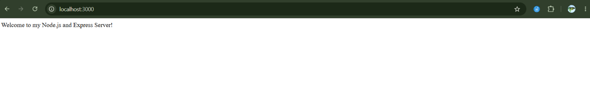
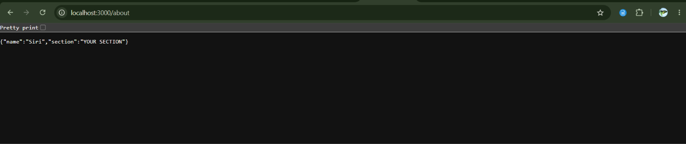
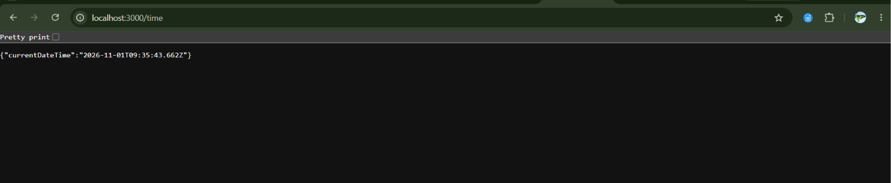
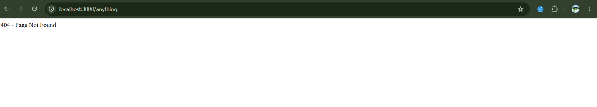

# Lab 1: Node.js and Express Server

## Deployment Link
Deployment pending.

## Student Details
- Name: Siri.R
- Registration Number: 252U2R8081
- Section: S-13,204,2B
- Course: B.Tech CSE (Quantum Engineering)

## 1. Aim
To create a basic HTTP server using Node.js and develop
a web server using Express.js. Implement different API
endpoints and handle invalid routes using HTTP status codes.

## 2. Technologies Used
- Node.js
- Express.js
- JavaScript
- Visual Studio Code

## 3. Installation

Step 1: Install Node.js.

Step 2: Clone the GitHub repository.

Step 3: Navigate to the lab-01 folder.

Step 4: Install the dependencies:

npm install

## 4. Execution

Run the following command:

npm start

The server runs at:

http://localhost:3000

## 5. API Endpoints

| HTTP Method | Endpoint | Description | Status |
|-------------|----------|-------------|--------|
| GET | / | Welcome message | 200 |
| GET | /about | Student details | 200 |
| GET | /time | Current date and time | 200 |
| GET | /anything | Not found response | 404 |

## 6. Screenshots

### Home Endpoint

### About Endpoint

### Time Endpoint

### 404 Endpoint

## 7. Learning Outcomes

- Understood Node.js and backend development.
- Learned to create an HTTP server using the built-in HTTP module.
- Understood Express.js framework.
- Implemented GET API endpoints.
- Learned HTTP status codes.
- Handled invalid routes using 404 responses.

## 8. Conclusion

Successfully created and tested a Node.js HTTP server
and an Express server. Implemented four endpoints and
verified their responses using a web browser.

## 9. Notes

- Node.js HTTP module was used to create the basic server.
- Express.js was used for simplified route handling.
- All four endpoints were tested successfully.
- Screenshots of the working endpoints are included above.

## 10. GitHub Repository

YOUR GITHUB REPOSITORY LINK
