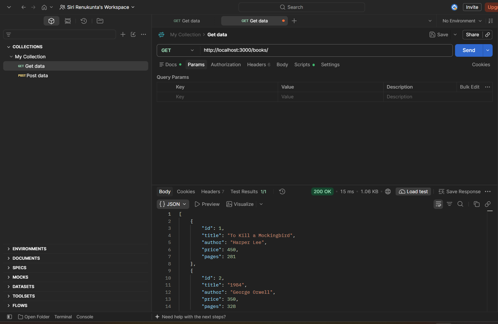
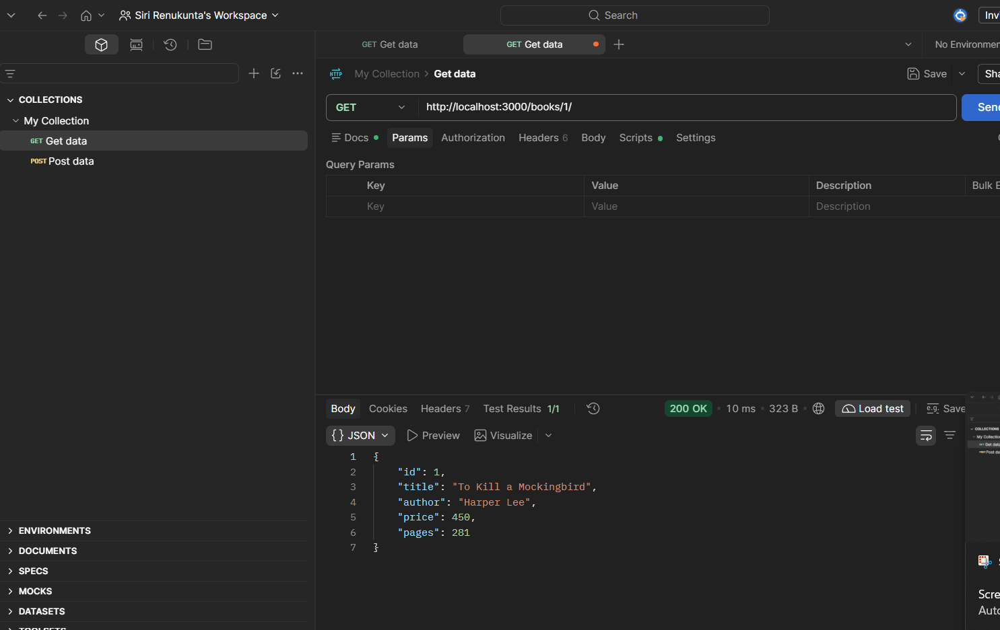
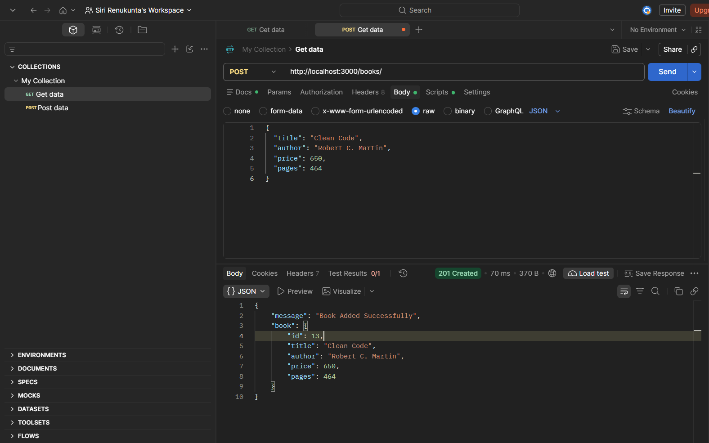
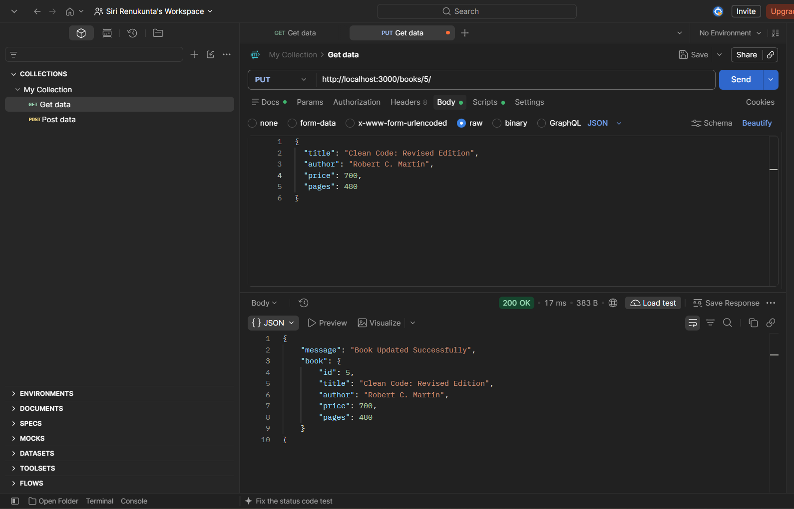
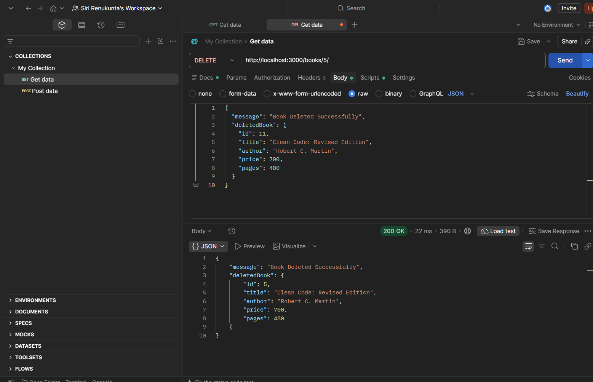

# Lab 2: SQLite database and CRUD routes

## Student Details
- **Name:** Siri.R
- **Registration Number:** 252U2R8081
- **Section:** S-13,204,2B
- **Course:** B.Tech CSE (Quantum Engineering)
- **Subject:** Backend Development Fundamentals (BDF)
- **Faculty:** Joel Prashanth D

---

## 1. Objective
To connect an Express.js web server to a persistent SQLite relational database using Node.js, and implement complete CRUD (Create, Read, Update, Delete) operations over HTTP RESTful API endpoints using parameterized SQL queries.

---

## 2. Technologies Used
- **Node.js:** JavaScript runtime environment for backend development.
- **Express.js (v5):** Minimalist web application framework for routing and middleware.
- **SQLite (sqlite3 & sqlite package):** Lightweight, serverless, file-based relational database.
- **JavaScript (ES6+):** Modern asynchronous JavaScript with `async/await` and Promises.
- **Nodemon:** Development utility that automatically restarts the server on file modifications.
- **Postman / Thunder Client:** API testing tools to construct HTTP requests and inspect responses.

---

## 3. Project Structure
The project follows a clean, modular MVC (Model-View-Controller / Model-Route-Controller) architecture:

```text
lab-02/
├── config/
│   └── database.js          # SQLite connection setup, table auto-creation & DB helper
├── controllers/
│   └── bookController.js    # Request handling, input validation & HTTP status responses
├── models/
│   └── bookModel.js         # Parameterized SQL database queries (CRUD operations)
├── routes/
│   └── bookRoutes.js        # Express route definitions for /books/ endpoints
├── screenshots/
│   └── README.md            # Evidence screenshot checklist and guidelines
├── database.db              # SQLite relational database storage file
├── package.json             # Project dependencies and npm execution scripts
├── package-lock.json        # Exact dependency tree lockfile
├── server.js                # Express app initialization & initializeDBAndServer()
├── test.js                  # Automated test suite covering all endpoints & database assertions
├── .gitignore               # Files excluded from Git tracking (node_modules, .env)
└── README.md                # Comprehensive Lab 02 documentation
```

---

## 4. Database Schema

The database file `database.db` contains the relational table `book` created according to the lab specifications:

### Table Name: `book`

| Column | Data Type | Constraints | Description |
|---|---|---|---|
| `id` | INTEGER | PRIMARY KEY AUTOINCREMENT | Unique identifier for each book |
| `title` | TEXT | NOT NULL | Title of the book |
| `author` | TEXT | NOT NULL | Full name of the author |
| `price` | INTEGER | NOT NULL | Price in local currency (positive integer) |
| `pages` | INTEGER | NOT NULL | Number of pages in the book (positive integer) |

### SQL Creation DDL:
```sql
CREATE TABLE IF NOT EXISTS book (
  id INTEGER PRIMARY KEY AUTOINCREMENT,
  title TEXT NOT NULL,
  author TEXT NOT NULL,
  price INTEGER NOT NULL,
  pages INTEGER NOT NULL
);
```

### Initial Data Inserted (10 Rows):
```sql
INSERT INTO book (title, author, price, pages) VALUES
('To Kill a Mockingbird', 'Harper Lee', 450, 281),
('1984', 'George Orwell', 350, 328),
('The Great Gatsby', 'F. Scott Fitzgerald', 299, 180),
('Pride and Prejudice', 'Jane Austen', 399, 279),
('The Catcher in the Rye', 'J.D. Salinger', 420, 234),
('The Hobbit', 'J.R.R. Tolkien', 499, 310),
('Fahrenheit 451', 'Ray Bradbury', 320, 249),
('Brave New World', 'Aldous Huxley', 380, 268),
('Crime and Punishment', 'Fyodor Dostoevsky', 550, 671),
('The Alchemist', 'Paulo Coelho', 250, 208);
```

---

## 5. Installation & Setup Instructions

### Prerequisites
- Node.js (version 18 or higher recommended)
- Git

### Step-by-Step Setup:

1. **Clone the repository:**
   ```bash
   git clone https://github.com/siree729/R-Siri.git
   cd R-Siri/lab-02
   ```

2. **Install dependencies:**
   ```bash
   npm install
   ```

3. **Configure Environment Variables:**
   Create an optional `.env` file in `lab-02/` if custom port binding is needed:
   ```env
   PORT=3000
   ```
   *(Defaults to `3000` if not specified).*

---

## 6. How to Run the Application

### Production Mode:
```bash
npm start
```
Starts `server.js` using Node.js.

### Development Mode (with hot-reload):
```bash
npm run dev
```
Runs the server with `nodemon`, automatically restarting whenever source files change.

### Run Automated Tests:
```bash
npm test
```
Executes `test.js` which verifies all 14 test cases including database persistence, parameterized queries, and HTTP status codes.

The server starts at:
```text
http://localhost:3000/
```

---

## 7. API Endpoints Documentation

All routes accept and return `application/json`.

| HTTP Method | Endpoint | Description | Status Code |
|---|---|---|---|
| `GET` | `/` | API welcome banner, student details, and route directory | `200 OK` |
| `GET` | `/books/` | Retrieve all books from the database | `200 OK` |
| `GET` | `/books/:bookId/` | Retrieve a single book by its primary key ID | `200 OK` / `404 Not Found` |
| `POST` | `/books/` | Add a new book into the database | `201 Created` / `400 Bad Request` |
| `PUT` | `/books/:bookId/` | Update an existing book's details by ID | `200 OK` / `400 Bad Request` / `404 Not Found` |
| `DELETE` | `/books/:bookId/` | Remove a book from the database by ID | `200 OK` / `404 Not Found` |

---

## 8. Sample Request and Response Examples

### 1. Retrieve All Books
- **Method:** `GET`
- **URL:** `http://localhost:3000/books/`
- **Response (`200 OK`):**
```json
[
  {
    "id": 1,
    "title": "To Kill a Mockingbird",
    "author": "Harper Lee",
    "price": 450,
    "pages": 281
  },
  {
    "id": 2,
    "title": "1984",
    "author": "George Orwell",
    "price": 350,
    "pages": 328
  }
]
```

### 2. Retrieve a Specific Book by ID
- **Method:** `GET`
- **URL:** `http://localhost:3000/books/1/`
- **Response (`200 OK`):**
```json
{
  "id": 1,
  "title": "To Kill a Mockingbird",
  "author": "Harper Lee",
  "price": 450,
  "pages": 281
}
```
- **Error Response for non-existent ID (`404 Not Found`):**
```json
{
  "error": "Book with ID 9999 not found."
}
```

### 3. Add a New Book (Create)
- **Method:** `POST`
- **URL:** `http://localhost:3000/books/`
- **Headers:** `Content-Type: application/json`
- **Request Body:**
```json
{
  "title": "Clean Code",
  "author": "Robert C. Martin",
  "price": 650,
  "pages": 464
}
```
- **Response (`201 Created`):**
```json
{
  "message": "Book Added Successfully",
  "book": {
    "id": 11,
    "title": "Clean Code",
    "author": "Robert C. Martin",
    "price": 650,
    "pages": 464
  }
}
```

### 4. Update an Existing Book
- **Method:** `PUT`
- **URL:** `http://localhost:3000/books/11/`
- **Headers:** `Content-Type: application/json`
- **Request Body:**
```json
{
  "title": "Clean Code: A Handbook of Agile Software Craftsmanship",
  "author": "Robert C. Martin",
  "price": 700,
  "pages": 480
}
```
- **Response (`200 OK`):**
```json
{
  "message": "Book Updated Successfully",
  "book": {
    "id": 11,
    "title": "Clean Code: A Handbook of Agile Software Craftsmanship",
    "author": "Robert C. Martin",
    "price": 700,
    "pages": 480
  }
}
```

### 5. Delete a Book
- **Method:** `DELETE`
- **URL:** `http://localhost:3000/books/11/`
- **Response (`200 OK`):**
```json
{
  "message": "Book Deleted Successfully",
  "deletedBook": {
    "id": 11,
    "title": "Clean Code: A Handbook of Agile Software Craftsmanship",
    "author": "Robert C. Martin",
    "price": 700,
    "pages": 480
  }
}
```

---

## 9. Viva Questions & Key Concepts

### Q1. Why await the database call?
> **Answer:**
> SQLite database queries are asynchronous I/O operations because reading from or writing to the disk takes time. If we do not use `await`, JavaScript will continue executing subsequent lines synchronously before the database query finishes, resulting in `undefined` data or unhandled Promises being sent to the client. Using `await` pauses execution until the database operation resolves, ensuring reliable data delivery.

### Q2. What is SQL injection and how do placeholders prevent it?
> **Answer:**
> **SQL Injection (SQLi)** is a security vulnerability where an attacker manipulates SQL queries by injecting malicious SQL fragments through user input fields (e.g. `1 OR 1=1; DROP TABLE book;`).
> When we use parameterized queries with `?` placeholders (e.g. `SELECT * FROM book WHERE id = ?`), the database driver treats the user input strictly as literal values rather than executable SQL commands, neutralizing malicious syntax and protecting database integrity.

### Q3. When is PUT used instead of POST?
> **Answer:**
> - **POST** is used to create a new resource on the server. It is non-idempotent, meaning calling POST multiple times creates multiple duplicate records.
> - **PUT** is used to update or replace an existing resource identified by a specific URI (e.g., `/books/:bookId/`). It is idempotent, meaning repeating the identical PUT request multiple times leaves the resource in the exact same state.

---

## 10. Screenshots of Working Output

### 1. GET /books/ (Retrieve All Books)


### 2. GET /books/:bookId/ (Retrieve Single Book)


### 3. POST /books/ (Add New Book)


### 4. PUT /books/:bookId/ (Update Book)


### 5. DELETE /books/:bookId/ (Delete Book)


---

## 11. Notes & Problems Solved

1. **Database-Server Synchronization (`initializeDBAndServer`):**
   - *Problem:* In an asynchronous environment, if the server starts accepting HTTP requests before the SQLite database file connection is established, incoming requests fail with database connection errors.
   - *Solution:* Implemented `initializeDBAndServer()` using `async/await`, ensuring `await initializeDB()` finishes before `app.listen()` begins accepting traffic.

2. **Preventing SQL Injection:**
   - *Problem:* Concatenating user inputs directly into SQL strings creates severe SQL injection vulnerabilities.
   - *Solution:* Applied parameterized queries using `?` placeholders across all model functions (`all()`, `get()`, `run()`), separating SQL commands from user input values.

3. **Data Type and Missing Field Validations:**
   - *Problem:* Clients may send missing fields, negative numbers, or invalid string types in JSON request payloads.
   - *Solution:* Added strict request body validation in `bookController.js` verifying that `title` and `author` are non-empty strings, `price` is a non-negative number, and `pages` is a positive integer. Invalid inputs return `400 Bad Request` with helpful error messages.

---

## 12. Deployment Link
- **Deployment Status:** Deployment pending / Local execution verified.
- **Live URL:** `https://siri-lab-2.onrender.com` *(or update when deployed on Render / Railway)*
- *Note:* If running in local laboratory environment, use `http://localhost:3000/`.

---

## 13. Conclusion
Lab 02 was completed successfully. The Express.js backend connects to SQLite (`database.db`), creates the `book` table, seeds initial records, and exposes the full RESTful CRUD interface (`GET`, `POST`, `PUT`, `DELETE`). All endpoints were verified against both the SQLite CLI and the automated test suite.

